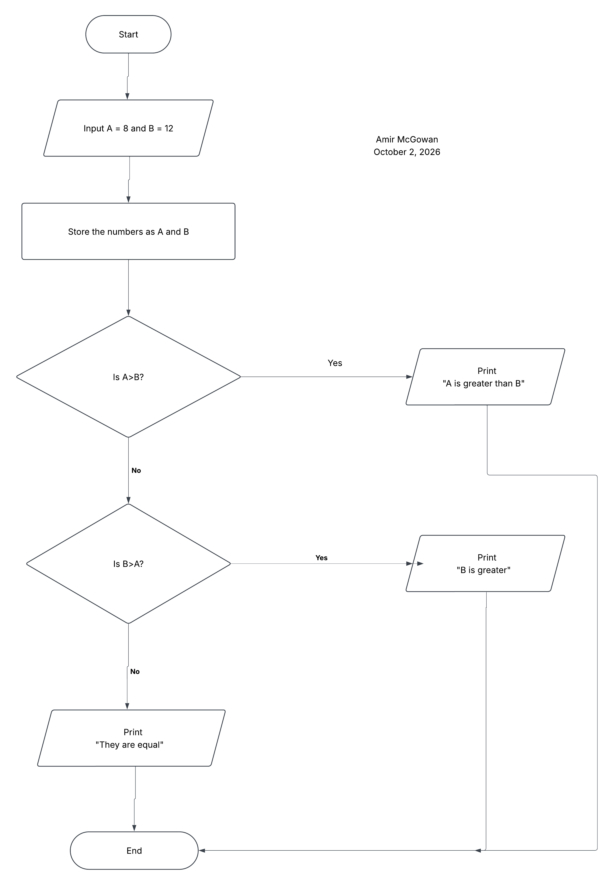

# Visualizing Logic

Amir McGowan  
October 2, 2026

This flowchart compares A = 8 and B = 12. It stores the inputs, then checks whether A is greater than B. If not, it checks whether B is greater than A. If both answers are no, the numbers are equal.

For these numbers, the output is “B is greater” because 12 is greater than 8.

